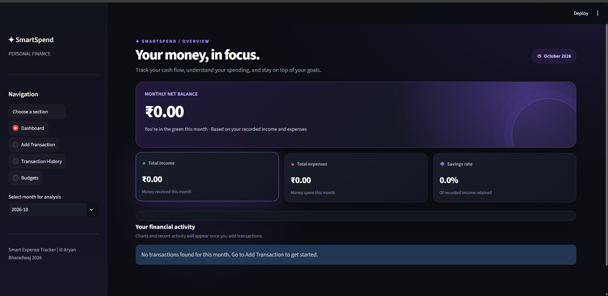
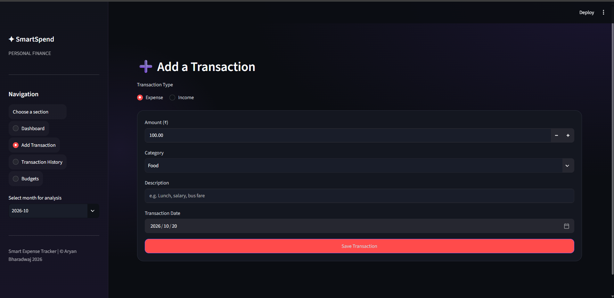
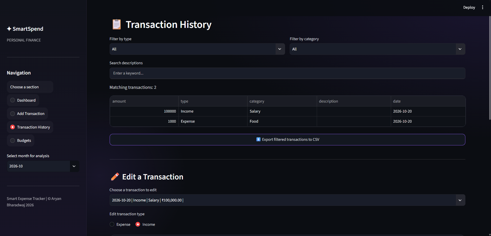

# 💰 Smart Expense Tracker

A simple and interactive **Smart Expense Tracker** built using Python and Streamlit. This application helps users manage their income and expenses, monitor their spending habits, set monthly budgets, and visualize their financial activities through charts.

## ✨ Features

- **Dashboard:** View your financial summary, including income, expenses, savings, and balance.
- **Add Transactions:** Record income and expenses with details such as amount, category, date, and description.
- **Manage Transactions:** Edit and delete existing transactions.
- **Transaction History:** View, search, and filter transactions.
- **Data Visualization:** Analyze spending patterns through interactive charts.
- **Monthly Budgets:** Set category-wise budgets and monitor spending.
- **CSV Export:** Export transaction records for further analysis.
- **Data Persistence:** Store application data locally using JSON files.
- **Interactive UI:** Dark-themed interface with purple accents and visual effects.

## 🛠️ Technologies Used

- **Python** — Application logic
- **Streamlit** — Web application interface
- **Pandas** — Data handling and analysis
- **Plotly** — Interactive charts
- **JSON** — Local data storage

## 📁 Project Structure

```text
Smart-Expense-Tracker/
│
├── app.py
├── expense_manager.py
├── requirements.txt
├── README.md
├── .gitignore
│
├── data/
│   └── .gitkeep
│
└── screenshots/
    ├── dashboard.png
    ├── add-transaction.png
    ├── transaction-history.png
    └── budgets.png
```

## 🚀 Installation and Setup

### 1. Clone the Repository

```bash
git clone https://github.com/YOUR-USERNAME/Smart-Expense-Tracker.git
```

Replace `YOUR-USERNAME` with your GitHub username.

### 2. Open the Project Folder

```bash
cd Smart-Expense-Tracker
```

### 3. Create a Virtual Environment (Optional)

```bash
python -m venv .venv
```

Activate it on Windows:

```bash
.venv\Scripts\activate
```

### 4. Install Dependencies

```bash
pip install -r requirements.txt
```

### 5. Run the Application

```bash
streamlit run app.py
```

The application will open in your web browser.

## 📸 Screenshots

Add screenshots of your application to the `screenshots/` folder and display them here.

### Dashboard



### Add Transaction



### Transaction History



### Monthly Budgets


## 📚 Concepts Demonstrated

- Python functions and modules
- Data management using JSON
- CRUD operations (Create, Read, Update, Delete)
- Data analysis using Pandas
- Interactive data visualization
- Streamlit application development
- CSV file handling
- Input validation and error handling

## 🔒 Data Privacy

The application stores transaction and budget data locally. Personal financial data files should not be uploaded to a public GitHub repository.

## 🔮 Future Improvements

- User authentication
- Database integration
- Recurring transaction support
- Downloadable financial reports
- Advanced spending analytics

## 👨‍💻 Project Information

**Project:** Smart Expense Tracker  
**Category:** Python Programming  
**Purpose:** Internship Week 6 Assignment

---

⭐ If you find this project useful, consider giving the repository a star.
