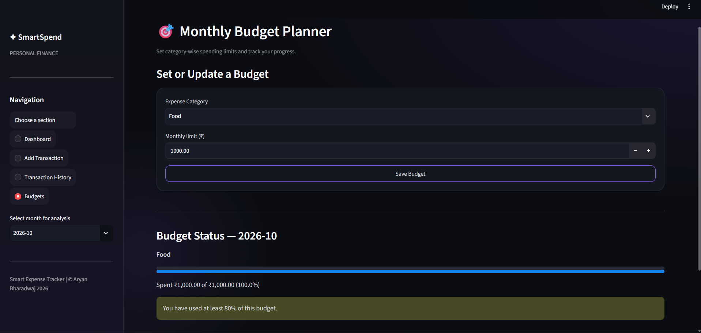

# 💰 Smart Expense Tracker

[](https://smart-expense-tracker-aryan.streamlit.app/) [](https://github.com/Aryansh1727/Smart-Expense-Tracker)

A Python-based personal finance management web application built using **Streamlit**. It helps users track income and expenses, manage monthly budgets, analyze spending patterns, and visualize financial data through an interactive dashboard.

## ✨ Features

- **Dashboard:** View balance, income, expenses, savings, charts, and recent transactions.
- **Add Transactions:** Record income and expenses with amount, category, date, and description.
- **Edit and Delete:** Update or remove existing transactions.
- **Transaction History:** Search, filter, and sort transaction records.
- **Budget Tracking:** Set category-wise monthly budgets and monitor spending.
- **Interactive Charts:** Visualize financial activity using Plotly.
- **CSV Export:** Export transaction records for further analysis.
- **Local Data Storage:** Store application data using JSON files during local use.
- **Modern UI:** Dark theme with purple accents and interactive dashboard elements.

## 🛠️ Technologies Used

- Python
- Streamlit
- Pandas
- Plotly
- JSON
- CSV
- Git and GitHub
- Streamlit Community Cloud

## 📁 Project Structure

```text
Smart-Expense-Tracker/
│
├── app.py
├── expense_manager.py
├── requirements.txt
├── README.md
├── .gitignore
│
├── data/
│   └── .gitkeep
│
└── screenshots/
    ├── dashboard.png
    ├── add-transaction.png
    ├── transaction-history.png
    └── budgets.png
```

## 🚀 Installation and Setup

### 1. Clone the Repository

```bash
git clone https://github.com/Aryansh1727/Smart-Expense-Tracker.git
```

### 2. Open the Project Folder

```bash
cd Smart-Expense-Tracker
```

### 3. Create a Virtual Environment (Optional)

```bash
python -m venv .venv
```

Activate it on Windows:

```powershell
.venv\Scripts\activate
```

### 4. Install Dependencies

```bash
pip install -r requirements.txt
```

### 5. Run the Application

```bash
streamlit run app.py
```

The application will open in your browser. If it doesn't open automatically, use the local URL displayed in the terminal.

## 📸 Screenshots

### Dashboard


### Add Transaction


### Transaction History


### Monthly Budgets



## 🧠 Python Concepts Implemented

- Functions and modular programming
- Variables and data types
- Conditional statements and loops
- Lists and dictionaries
- File handling using JSON and CSV
- Input validation and error handling where implemented
- CRUD operations (Create, Read, Update, Delete)
- Use of external Python libraries

## 🔒 Data Privacy

The application uses local JSON files for data persistence during local use. The `.gitignore` file excludes local data files, environment files, Python cache files, and virtual environments from Git tracking.

**Important:** The live application is intended as a demonstration. Avoid entering real or sensitive financial information. Local file storage on a hosted platform may not persist across restarts or redeployments.

## 🔮 Future Improvements

- Database integration using SQLite or PostgreSQL
- User authentication and individual accounts
- Recurring transactions and reminders
- Downloadable monthly and yearly reports
- Savings goals and advanced spending analytics
- Automated testing

## 👨‍💻 Project Information

- **Project Name:** Smart Expense Tracker
- **Project Type:** Python Web Application
- **Internship Domain:** Python Programming

## 🔗 Project Links

- **Live Demo:** https://smart-expense-tracker-aryan.streamlit.app/
- **GitHub Repository:** https://github.com/Aryansh1727/Smart-Expense-Tracker

---

Developed as part of the Python Programming internship project.
